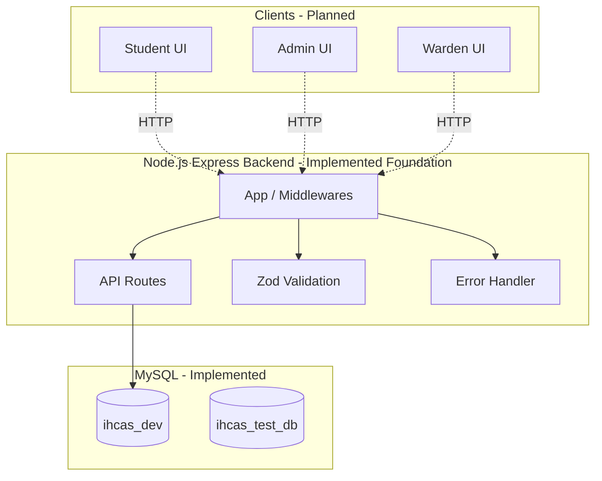
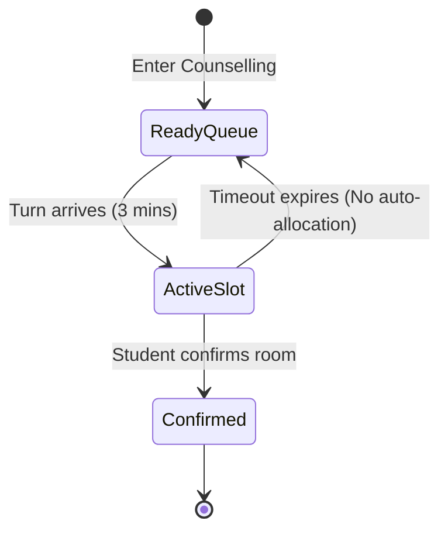

# Intelligent Hostel Counselling & Allocation System (IHCAS)

## A. Project Overview
Intelligent Hostel Counselling & Allocation System (IHCAS) is a full-stack hostel counselling, allocation, and management platform designed to digitize the hostel allocation process for students, administrators, and wardens.

**Intended Users:**
- Students: Participate in rank-based counselling and secure rooms.
- Administrators: Configure sessions, import data, and monitor allocations.
- Wardens: Manage hostels, process leave/room-change requests.

**Technical Stack:**
- **Frontend:** React with JSX (Planned)
- **Backend:** Node.js + Express (Implemented Foundation)
- **Database:** MySQL with InnoDB (Implemented Schema & Setup)
- **Testing:** Jest, Supertest

**Current Status:** Phase 13 (Comprehensive Test Data and Functional Validation) is Complete.

## B. Feature and Phase Status
- **Phase 0: Repository Audit and Project Setup** - ✅ Complete
- **Phase 1: Relational Database Design** - ✅ Complete
- **Phase 2: Backend Foundation** - ✅ Complete
- **Phase 3: Authentication and User Data** - ✅ Complete
- **Phase 4: Hostel Inventory and Availability** - ✅ Complete
- **Phase 5: Counselling Queue and Sessions** - ✅ Complete (Session config, Queue priority, Server-side timeout)
- **Phase 6: Allocation Engine and Roommate Verification** - ✅ Complete (Atomic allocation, Roommate DB OTP audit & Nodemailer delivery, Room locking, Concurrency)
- **Phase 8a: Domain Enforcement & OAuth Foundation** - ✅ Complete (VIT domains restricted, Google OAuth 2.0 mocked & tested)
- **Phase 8c: Gender-Separated Hostel & Room Allocation Rules** - ✅ Complete (Strict `MH-`/`LH-` hostel naming, cross-gender block, roommate gender verification)
- **Phase 7: Student Experience and Post-Allocation Features** - ✅ Complete (Requests module, Notifications, Student Dashboard API & React UI)
- **Phase 8b: Administrator and Warden Workspaces** - ✅ Complete (Warden dashboard UI, access isolation, request approvals, and announcements)
- **Phase 9: AI Integration** - ❌ Deferred until after non-AI phases
- **Phase 10: Frontend Integration and Design QA** - ✅ Complete (UI/UX overhaul, duplicate submission guards, clean tables)
- **Phase 11: Admin Dashboard and Administrative Operations** - ✅ Complete (Admin Dashboard UI, global stats, counselling generator, room selection dropdown)
- **Phase 12: Hardening, Deployment** - ✅ Complete (Security headers, rate limiting, Deployment.md, production DB guidelines)
- **Phase 13: Comprehensive Test Data and Functional Validation** - ✅ Complete (100 students, 6 hostels, 60 rooms, active counselling queue, 39/39 functional checks pass)

## C. Installation and Local Development
**Prerequisites:**
- Node.js v24+
- npm
- MySQL Server (listening on port 3306)

**Repository Setup:**
Clone the repository and ensure you have the `ihcas` folder structure.

**Backend Setup:**
```bash
cd ihcas/backend
npm install
```

**Environment Configuration:**
Copy `.env.example` to `.env` in `ihcas/backend`:
```env
PORT=3000
CORS_ORIGIN=http://localhost:5173
DB_HOST=127.0.0.1
DB_PORT=3306
DB_USER=root
DB_PASSWORD=your_password
DB_NAME=ihcas_dev
TEST_DB_NAME=ihcas_test_db
JWT_SECRET=your_jwt_secret
OTP_PROVIDER=TEST_MOCK
GOOGLE_CLIENT_ID=your-google-client-id
GOOGLE_CLIENT_SECRET=your-google-client-secret
GOOGLE_CALLBACK_URL=http://localhost:3000/api/auth/google/callback
```

**Database Initialization & Seeding:**
```bash
# In ihcas/backend
node scripts/migrate.js
npm run seed              # Runs idempotent Phase 13 seeder (100 students, 6 hostels, 60 rooms, active counselling)
node scripts/setup-test-db.js
```

**Starting the Backend:**
```bash
# In ihcas/backend
node src/server.js
```

**Running Functional Validation & Tests:**
```bash
# In ihcas/backend
npm run verify:phase13    # Executes comprehensive 39-point functional verification on ihcas_dev
npm test                  # Executes full integration test suite against isolated ihcas_test_db
```

### Development Demo Accounts & Credentials
All seeded test accounts use the password: `DemoPassword123!`

| Role | Name | Email | Reg No / ID | Gender | Assigned Hostel / Scope | Dashboard Route |
| :--- | :--- | :--- | :--- | :--- | :--- | :--- |
| **ADMIN** | System Administrator | `admin@vit.ac.in` | `ADM001` | - | Global Campus Oversight | `/admin/dashboard` |
| **WARDEN** | MH-A Chief Warden | `warden@vit.ac.in` | `WRD001` | MALE | `MH-A` (North Campus) | `/warden/dashboard` |
| **WARDEN** | MH-B Senior Warden | `warden.mhb@vit.ac.in` | `WRD002` | MALE | `MH-B` (Central Campus) | `/warden/dashboard` |
| **WARDEN** | MH-C Associate Warden | `warden.mhc@vit.ac.in` | `WRD003` | MALE | `MH-C` (South Campus) | `/warden/dashboard` |
| **WARDEN** | LH-A Chief Warden | `warden.lha@vit.ac.in` | `WRD004` | FEMALE | `LH-A` (East Campus) | `/warden/dashboard` |
| **WARDEN** | LH-B Senior Warden | `warden.lhb@vit.ac.in` | `WRD005` | FEMALE | `LH-B` (West Campus) | `/warden/dashboard` |
| **WARDEN** | LH-C Associate Warden | `warden.lhc@vit.ac.in` | `WRD006` | FEMALE | `LH-C` (North-East Campus) | `/warden/dashboard` |
| **STUDENT** | Aarav Sharma (Rank 1) | `aarav.sharma24@vitstudent.ac.in` | `24BCE1001` | MALE | Eligible for `MH-*` (Queue #1) | `/dashboard` |
| **STUDENT** | Aanya Gupta (Rank 2) | `aanya.gupta24@vitstudent.ac.in` | `24BCE2001` | FEMALE | Eligible for `LH-*` (Queue #2) | `/dashboard` |
| **STUDENT** | Vihaan Patel (Rank 3) | `vihaan.patel24@vitstudent.ac.in` | `24BCE1002` | MALE | Eligible for `MH-*` (Queue #3) | `/dashboard` |
| **STUDENT** | Diya Verma (Rank 4) | `diya.verma24@vitstudent.ac.in` | `24BCE2002` | FEMALE | Eligible for `LH-*` (Queue #4) | `/dashboard` |

### Top 10 Eligible Students in Active Counselling Queue
All unallocated students (Ranks 1 to 88) are in `PENDING` queue status with an active 2026-2027 session and 3-minute timers:

| Queue Pos | Name | Email | Reg Number | Gender | Rank | CGPA | Department | Status |
| :---: | :--- | :--- | :--- | :---: | :---: | :---: | :---: | :---: |
| **1** | Aarav Sharma | `aarav.sharma24@vitstudent.ac.in` | `24BCE1001` | MALE | **1** | 9.95 | BCE | PENDING (Front) |
| **2** | Aanya Gupta | `aanya.gupta24@vitstudent.ac.in` | `24BCE2001` | FEMALE | **2** | 9.93 | BCE | PENDING |
| **3** | Vihaan Patel | `vihaan.patel24@vitstudent.ac.in` | `24BCE1002` | MALE | **3** | 9.90 | BCE | PENDING |
| **4** | Diya Verma | `diya.verma24@vitstudent.ac.in` | `24BCE2002` | FEMALE | **4** | 9.88 | BCE | PENDING |
| **5** | Vivaan Gupta | `vivaan.gupta24@vitstudent.ac.in` | `24BCE1003` | MALE | **5** | 9.85 | BCE | PENDING |
| **6** | Ishita Sharma | `ishita.sharma24@vitstudent.ac.in` | `24BCE2003` | FEMALE | **6** | 9.83 | BCE | PENDING |
| **7** | Aditya Kumar | `aditya.kumar24@vitstudent.ac.in` | `24BCE1004` | MALE | **7** | 9.80 | BCE | PENDING |
| **8** | Riya Sen | `riya.sen24@vitstudent.ac.in` | `24BCE2004` | FEMALE | **8** | 9.78 | BCE | PENDING |
| **9** | Reyansh Verma | `reyansh.verma24@vitstudent.ac.in` | `24BCE1005` | MALE | **9** | 9.75 | BCE | PENDING |
| **10** | Saanvi Patel | `saanvi.patel24@vitstudent.ac.in` | `24BCE2005` | FEMALE | **10** | 9.73 | BCE | PENDING |


## D. Repository and Directory Structure
```text
ihcas/
├── Documentation/             # Architecture, design, PRD, workflows
├── IHCAS_Walkthrough.md       # Operational log and test evidence
├── README.md                  # This document
└── ihcas/
    ├── frontend/              # (Planned React UI)
    │   └── package.json
    └── backend/               # (Implemented Express Backend)
        ├── .env.example
        ├── package.json
        ├── scripts/
        │   ├── migrate.js
        │   ├── seed.js
        │   └── setup-test-db.js
        ├── src/
        │   ├── app.js
        │   ├── server.js
        │   ├── config/db.js
        │   ├── middleware/    # errorHandler.js, validate.js
        │   └── routes/        # health.routes.js
        └── tests/             # Jest tests
```

## E. System Architecture


*(Dotted lines indicate planned communication, solid lines indicate implemented foundation).*

## F. API Documentation

### Implemented Endpoints

#### 1. System Health Check
- **Method & Path:** `GET /api/health`
- **Purpose:** Confirms the Express application is responsive.
- **Authentication:** None.
- **Example Response (200 OK):**
```json
{
  "success": true,
  "message": "Application is responsive",
  "timestamp": "2026-10-10T00:00:00.000Z"
}
```

#### 2. Database Health Check
- **Method & Path:** `GET /api/health/db`
- **Purpose:** Verifies that the MySQL database is reachable.
- **Authentication:** None.
- **Example Response (200 OK):**
```json
{
  "success": true,
  "message": "Database is reachable",
  "timestamp": "2026-10-10T00:00:00.000Z"
}
```
- **Error Response (503 Service Unavailable):**
```json
{
  "success": false,
  "error": {
    "message": "Database connection failed"
  }
}
```

#### 3. Login
- **Method & Path:** `POST /api/auth/login`
- **Purpose:** Authenticates a user and issues a JWT token cookie.
- **Authentication:** None (Rate-limited to 10 requests / 15 mins).
- **Request Body:**
```json
{
  "email": "student1@testusers.com",
  "password": "password123"
}
```
- **Example Response (200 OK):**
```json
{
  "success": true,
  "data": {
    "user": {
      "user_id": 1,
      "name": "Student One",
      "email": "student1@testusers.com",
      "role": "STUDENT"
    }
  }
}
```

#### 4. Get Current Profile
- **Method & Path:** `GET /api/users/me`
- **Purpose:** Retrieves the authenticated user's profile and role-specific details.
- **Authentication:** Required (Valid JWT cookie).
- **Example Response (200 OK):**
```json
{
  "success": true,
  "data": {
    "user_id": 1,
    "name": "Student One",
    "email": "student1@testusers.com",
    "role": "STUDENT",
    "profile": {
      "reg_no": "STU001",
      "phone": "1234567890"
    }
  }
}
```

#### 5. Update Profile
- **Method & Path:** `PUT /api/users/me`
- **Purpose:** Updates permitted fields on the authenticated user's profile.
- **Authentication:** Required.
- **Request Body:**
```json
{
  "phone": "0987654321"
}
```

#### 6. Get Any User Profile (Admin Only)
- **Method & Path:** `GET /api/users/:id`
- **Purpose:** Retrieves any user's profile.
- **Authentication:** Required.
- **Required Role:** `ADMIN`

#### 7. Inventory: Hostels
- **Method & Path:** `GET /api/inventory/hostels` (Accessible by all roles; Students only see hostels matching their gender)
- **Method & Path:** `POST /api/inventory/hostels` (Admin only)
- **Method & Path:** `PUT /api/inventory/hostels/:id` (Admin only)

#### 8. Inventory: Room Types
- **Method & Path:** `GET /api/inventory/room-types`
- **Method & Path:** `POST /api/inventory/room-types` (Admin only)

#### 9. Inventory: Rooms and Availability
- **Method & Path:** `GET /api/inventory/rooms?hostel_id=1`
- **Purpose:** Fetches rooms, calculating `occupied_beds` dynamically from active allocations (`CONFIRMED` or `LOCKED`) ensuring accuracy. Returns `available_capacity` and `is_available`. (Filtered by student gender or restricted to Warden's assigned hostel).
- **Method & Path:** `POST /api/inventory/rooms` (Admin only)
- **Method & Path:** `PUT /api/inventory/rooms/:id` (Admin, or Warden if room belongs to Warden's assigned hostel)

#### 10. Counselling Session Config
- **Method & Path:** `POST /api/counselling/sessions`
- **Purpose:** Create a new counselling session.
- **Authentication:** Admin only.

#### 11. Slot Generation
- **Method & Path:** `POST /api/counselling/sessions/:id/generate-slots`
- **Purpose:** Dynamically populate counselling queue ordered by `academic_rank` ASC, `cgpa` DESC for all students without a confirmed/locked allocation.
- **Authentication:** Admin only.

#### 12. Student Queue Status & Activation
- **Method & Path:** `GET /api/counselling/status`
- **Purpose:** Fetches current slot status and exact queue position. Actively detects and expires (returns to ready queue) slots that have passed their 3-minute deadline.
- **Authentication:** Student only.
- **Method & Path:** `POST /api/counselling/activate`
- **Purpose:** Starts the 3-minute counselling session. Validates that the student is front-of-queue or their original scheduled time has passed. Protects against duplicate sessions and concurrent race conditions.

#### 13. Roommate Verification (OTP)
- **Method & Path:** `POST /api/allocation/roommate-otp/request`
- **Purpose:** Initiates OTP verification for a target roommate by generating and storing a 6-digit OTP. Validates gender and existing allocations.
- **Authentication:** Student only.
- **Method & Path:** `POST /api/allocation/roommate-otp/verify`
- **Purpose:** Verifies a submitted OTP securely. Enforces 10-minute expiry and attempt limits to prevent brute forcing.

#### 14. Room Allocation Engine
- **Method & Path:** `POST /api/allocation`
- **Purpose:** Confirms room allocation for a student and any verified roommates. Uses MySQL transactions and row locking (`FOR UPDATE` on `STUDENT` and `ROOM`) to prevent concurrency deadlocks, capacity overbooking, and duplicate allocations.
- **Authentication:** Student only. Requires a valid, active counselling slot.

## G. Database Documentation
- **MySQL & InnoDB**: Chosen for standard relational constraints and transaction safety.
- **Migrations**: Versioned and executed via `scripts/migrate.js`. The baseline schema is in `database/schema.sql`.
- **Seeds**: Base lookup tables and testing data populated via `scripts/seed.js`.
- **Authoritative ERD**: Located at `Documentation/IHCAS_ER_Diagram`.
- **Test DB Separation**: `ihcas_dev` is strictly for development. Integration tests run ONLY on `ihcas_test_db` to protect local dev data.
- **Core Entities**: `USER`, `STUDENT`, `HOSTEL`, `ROOM`, `ALLOCATION`. Note that allocations tie to a `ROOM`, not a bed.

## H. Business Rules and Workflow
- **Rank-based Priority**: Counselling slots are offered in order of academic rank.
- **Three-Minute Slots**: Students have precisely 3 minutes to confirm an allocation.
- **Timeout Strategy**: If a timeout occurs, NO automatic allocation happens. The student is returned to the ready queue with their original rank priority. Room availability is fully refreshed upon re-entry.
- **Room-Level Allocation**: The system allocates rooms, not individual beds. Bed distribution is handled socially by the roommates.



## I. Security and Configuration
- **Environment Variables**: Essential secrets are kept in `.env` (excluded from git).
- **Validation**: Incoming request validation is strictly enforced using `zod`.
- **Error Handling**: A centralized error handler blocks internal stack traces from bleeding into API responses.
- **CORS**: Configurable and restrictive origins based on configuration.
- **Authentication**: JWT-based session management. Tokens are stored in HttpOnly cookies to prevent XSS attacks.
- **Passwords**: Hashed using `bcryptjs` with a cost factor of 10.
- **Rate Limiting**: Applied to login endpoints to prevent brute-force credential stuffing.
- **Authorization**: Role-based access control (RBAC) enforced at the route level via middleware (`requireRole`).

## J. Testing and Quality Assurance
- **Framework**: Jest and Supertest.
- **Coverage**:
  - **Unit**: Middleware, input validation, and graceful shutdown (`server.test.js`, `app.test.js`).
  - **Integration**: Database operations, constraints, rollbacks (`db.test.js`).
- **Running Tests**: Run `npm test` inside `ihcas/backend`. Tests use `ihcas_test_db`.
- **Verification Evidence**: See `IHCAS_Walkthrough.md` for full test logs and step-by-step verification statuses.

## K. Deployment and Operations
- **Current State**: Local development only.
- **Planned**: Node.js managed host, managed MySQL, HTTPS, and automated deployments.

## L. Team Development and Contribution Guide
- **Setup**: Clone the repo, run `npm install` in backend, copy env files, start MySQL, run migrations.
- **Adding an API Module**: 
  1. Add route in `src/routes/`.
  2. Mount in `src/app.js`.
  3. Validate input with Zod using `src/middleware/validate.js`.
- **Documentation**: Update `README.md` and `IHCAS_Walkthrough.md` when introducing new features.
- **Branching**: Use feature branches and Pull Requests.

## M. Documentation Governance
- **`README.md`**: Project overview, architecture, setup, implemented API reference, testing commands.
- **`IHCAS_Walkthrough.md`**: Operational logs, test evidence, bug tracing.
- **`Documentation/IHCAS_Completed.md`**: Authoritative phase completion statuses.
- **`Documentation/IHCAS_implementation_v2.md`**: Execution sequence (AI deferred to the end).
- **`Documentation/IHCAS_PRD_v2.md`**: Business requirements.
- **`Documentation/IHCAS_architecture_v2.md`**: Approved system architecture.
- **`Documentation/IHCAS_workflow_v2.md`**: Expected workflows.
- **`Documentation/IHCAS_design_v2.md`**: UI/UX design requirements.
- **`Documentation/IHCAS_ER_Diagram`**: Authoritative ER model.
