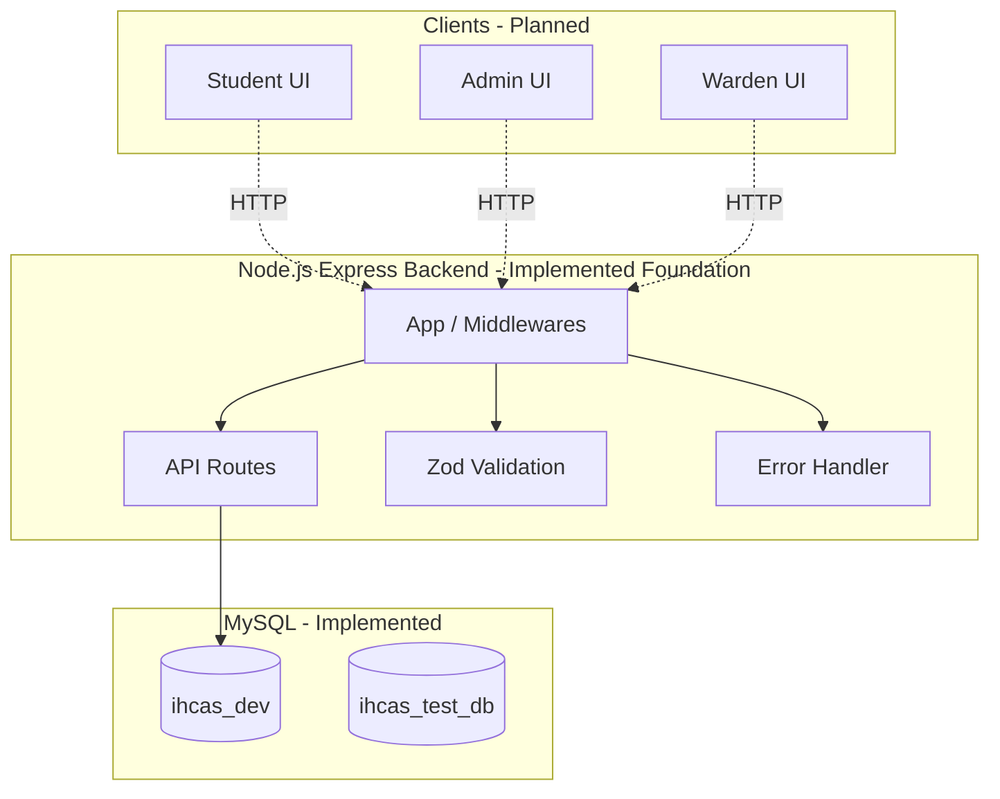
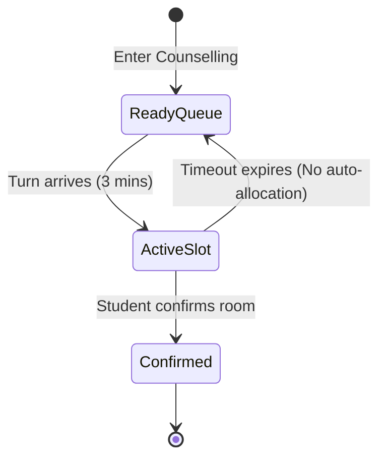

# Intelligent Hostel Counselling & Allocation System (IHCAS)

## A. Project Overview
Intelligent Hostel Counselling & Allocation System (IHCAS) is a full-stack hostel counselling, allocation, and management platform designed to digitize the hostel allocation process for students, administrators, and wardens.

**Intended Users:**
- Students: Participate in rank-based counselling and secure rooms.
- Administrators: Configure sessions, import data, and monitor allocations.
- Wardens: Manage hostels, process leave/room-change requests.

**Technical Stack:**
- **Frontend:** React with JSX (Planned)
- **Backend:** Node.js + Express (Implemented Foundation)
- **Database:** MySQL with InnoDB (Implemented Schema & Setup)
- **Testing:** Jest, Supertest

**Current Status:** Phase 3 (Authentication and User Data) is Complete.

## B. Feature and Phase Status
- **Phase 0: Repository Audit and Project Setup** - ✅ Complete
- **Phase 1: Relational Database Design** - ✅ Complete
- **Phase 2: Backend Foundation** - ✅ Complete
- **Phase 3: Authentication and User Data** - ✅ Complete (JWT Sessions, Bcrypt, Profile Management, Role-Based Auth)
- **Phase 4-8: Business Logic & Dashboards** - ❌ Not Started
- **Phase 9: AI Integration** - ❌ Deferred until after Phase 12
- **Phase 10-12: Frontend, Hardening, Deployment** - ❌ Not Started

## C. Installation and Local Development
**Prerequisites:**
- Node.js v24+
- npm
- MySQL Server (listening on port 3306)

**Repository Setup:**
Clone the repository and ensure you have the `ihcas` folder structure.

**Backend Setup:**
```bash
cd ihcas/backend
npm install
```

**Environment Configuration:**
Copy `.env.example` to `.env` in `ihcas/backend`:
```env
PORT=3000
CORS_ORIGIN=http://localhost:5173
DB_HOST=127.0.0.1
DB_PORT=3306
DB_USER=root
DB_PASSWORD=your_password
DB_NAME=ihcas_dev
TEST_DB_NAME=ihcas_test_db
```

**Database Initialization:**
```bash
# In ihcas/backend
node scripts/migrate.js
node scripts/seed.js
node scripts/setup-test-db.js
```

**Starting the Backend:**
```bash
# In ihcas/backend
node src/server.js
```

**Running Tests:**
```bash
# In ihcas/backend
npm test
```

## D. Repository and Directory Structure
```text
ihcas/
├── Documentation/             # Architecture, design, PRD, workflows
├── IHCAS_Walkthrough.md       # Operational log and test evidence
├── README.md                  # This document
└── ihcas/
    ├── frontend/              # (Planned React UI)
    │   └── package.json
    └── backend/               # (Implemented Express Backend)
        ├── .env.example
        ├── package.json
        ├── scripts/
        │   ├── migrate.js
        │   ├── seed.js
        │   └── setup-test-db.js
        ├── src/
        │   ├── app.js
        │   ├── server.js
        │   ├── config/db.js
        │   ├── middleware/    # errorHandler.js, validate.js
        │   └── routes/        # health.routes.js
        └── tests/             # Jest tests
```

## E. System Architecture


*(Dotted lines indicate planned communication, solid lines indicate implemented foundation).*

## F. API Documentation

### Implemented Endpoints

#### 1. System Health Check
- **Method & Path:** `GET /api/health`
- **Purpose:** Confirms the Express application is responsive.
- **Authentication:** None.
- **Example Response (200 OK):**
```json
{
  "success": true,
  "message": "Application is responsive",
  "timestamp": "2026-10-10T00:00:00.000Z"
}
```

#### 2. Database Health Check
- **Method & Path:** `GET /api/health/db`
- **Purpose:** Verifies that the MySQL database is reachable.
- **Authentication:** None.
- **Example Response (200 OK):**
```json
{
  "success": true,
  "message": "Database is reachable",
  "timestamp": "2026-10-10T00:00:00.000Z"
}
```
- **Error Response (503 Service Unavailable):**
```json
{
  "success": false,
  "error": {
    "message": "Database connection failed"
  }
}
```

#### 3. Login
- **Method & Path:** `POST /api/auth/login`
- **Purpose:** Authenticates a user and issues a JWT token cookie.
- **Authentication:** None (Rate-limited to 10 requests / 15 mins).
- **Request Body:**
```json
{
  "email": "student1@testusers.com",
  "password": "password123"
}
```
- **Example Response (200 OK):**
```json
{
  "success": true,
  "data": {
    "user": {
      "user_id": 1,
      "name": "Student One",
      "email": "student1@testusers.com",
      "role": "STUDENT"
    }
  }
}
```

#### 4. Get Current Profile
- **Method & Path:** `GET /api/users/me`
- **Purpose:** Retrieves the authenticated user's profile and role-specific details.
- **Authentication:** Required (Valid JWT cookie).
- **Example Response (200 OK):**
```json
{
  "success": true,
  "data": {
    "user_id": 1,
    "name": "Student One",
    "email": "student1@testusers.com",
    "role": "STUDENT",
    "profile": {
      "reg_no": "STU001",
      "phone": "1234567890"
    }
  }
}
```

#### 5. Update Profile
- **Method & Path:** `PUT /api/users/me`
- **Purpose:** Updates permitted fields on the authenticated user's profile.
- **Authentication:** Required.
- **Request Body:**
```json
{
  "phone": "0987654321"
}
```

#### 6. Get Any User Profile (Admin Only)
- **Method & Path:** `GET /api/users/:id`
- **Purpose:** Retrieves any user's profile.
- **Authentication:** Required.
- **Required Role:** `ADMIN`

*(Business endpoints such as hostels and counselling are planned for future phases).*

## G. Database Documentation
- **MySQL & InnoDB**: Chosen for standard relational constraints and transaction safety.
- **Migrations**: Versioned and executed via `scripts/migrate.js`. The baseline schema is in `database/schema.sql`.
- **Seeds**: Base lookup tables and testing data populated via `scripts/seed.js`.
- **Authoritative ERD**: Located at `Documentation/IHCAS_ER_Diagram`.
- **Test DB Separation**: `ihcas_dev` is strictly for development. Integration tests run ONLY on `ihcas_test_db` to protect local dev data.
- **Core Entities**: `USER`, `STUDENT`, `HOSTEL`, `ROOM`, `ALLOCATION`. Note that allocations tie to a `ROOM`, not a bed.

## H. Business Rules and Workflow
- **Rank-based Priority**: Counselling slots are offered in order of academic rank.
- **Three-Minute Slots**: Students have precisely 3 minutes to confirm an allocation.
- **Timeout Strategy**: If a timeout occurs, NO automatic allocation happens. The student is returned to the ready queue with their original rank priority. Room availability is fully refreshed upon re-entry.
- **Room-Level Allocation**: The system allocates rooms, not individual beds. Bed distribution is handled socially by the roommates.



## I. Security and Configuration
- **Environment Variables**: Essential secrets are kept in `.env` (excluded from git).
- **Validation**: Incoming request validation is strictly enforced using `zod`.
- **Error Handling**: A centralized error handler blocks internal stack traces from bleeding into API responses.
- **CORS**: Configurable and restrictive origins based on configuration.
- **Authentication**: JWT-based session management. Tokens are stored in HttpOnly cookies to prevent XSS attacks.
- **Passwords**: Hashed using `bcryptjs` with a cost factor of 10.
- **Rate Limiting**: Applied to login endpoints to prevent brute-force credential stuffing.
- **Authorization**: Role-based access control (RBAC) enforced at the route level via middleware (`requireRole`).

## J. Testing and Quality Assurance
- **Framework**: Jest and Supertest.
- **Coverage**:
  - **Unit**: Middleware, input validation, and graceful shutdown (`server.test.js`, `app.test.js`).
  - **Integration**: Database operations, constraints, rollbacks (`db.test.js`).
- **Running Tests**: Run `npm test` inside `ihcas/backend`. Tests use `ihcas_test_db`.
- **Verification Evidence**: See `IHCAS_Walkthrough.md` for full test logs and step-by-step verification statuses.

## K. Deployment and Operations
- **Current State**: Local development only.
- **Planned**: Node.js managed host, managed MySQL, HTTPS, and automated deployments.

## L. Team Development and Contribution Guide
- **Setup**: Clone the repo, run `npm install` in backend, copy env files, start MySQL, run migrations.
- **Adding an API Module**: 
  1. Add route in `src/routes/`.
  2. Mount in `src/app.js`.
  3. Validate input with Zod using `src/middleware/validate.js`.
- **Documentation**: Update `README.md` and `IHCAS_Walkthrough.md` when introducing new features.
- **Branching**: Use feature branches and Pull Requests.

## M. Documentation Governance
- **`README.md`**: Project overview, architecture, setup, implemented API reference, testing commands.
- **`IHCAS_Walkthrough.md`**: Operational logs, test evidence, bug tracing.
- **`Documentation/IHCAS_Completed.md`**: Authoritative phase completion statuses.
- **`Documentation/IHCAS_implementation_v2.md`**: Execution sequence (AI deferred to the end).
- **`Documentation/IHCAS_PRD_v2.md`**: Business requirements.
- **`Documentation/IHCAS_architecture_v2.md`**: Approved system architecture.
- **`Documentation/IHCAS_workflow_v2.md`**: Expected workflows.
- **`Documentation/IHCAS_design_v2.md`**: UI/UX design requirements.
- **`Documentation/IHCAS_ER_Diagram`**: Authoritative ER model.
